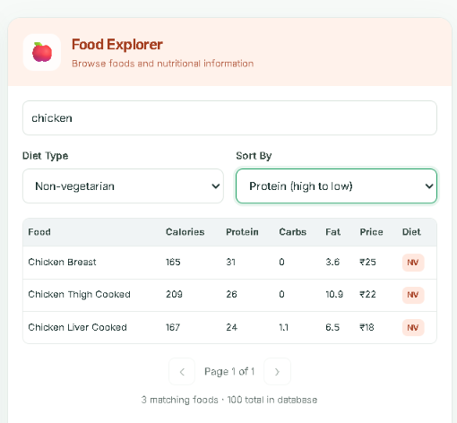
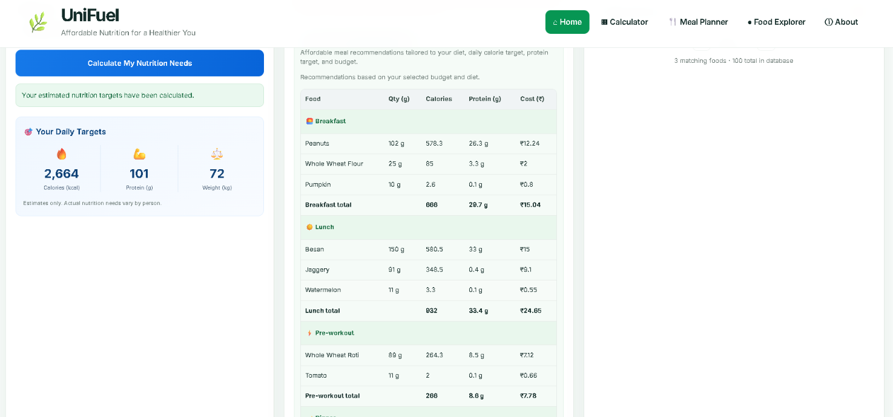
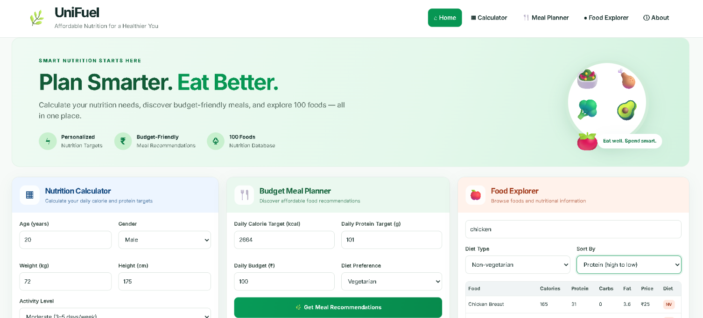

# 🥗 UniFuel — Smart Nutrition & Meal Planning

**Affordable nutrition. Smarter meals. Better fitness.**

UniFuel is a nutrition and meal-planning application designed to help university students discover affordable foods, calculate their daily nutritional requirements, and generate personalized meal plans based on their calorie goals, protein targets, dietary preferences, and budget.

The goal is simple: make eating well more accessible to students without requiring expensive meal plans or complicated nutritional calculations.

---

## 📌 Table of Contents

- [About the Project](#-about-the-project)
- [Key Features](#-key-features)
- [Technology Stack](#-technology-stack)
- [Application Architecture](#-application-architecture)
- [Getting Started](#-getting-started)
- [Configuration](#-configuration)
- [API Endpoints](#-api-endpoints)
- [How Meal Planning Works](#-how-meal-planning-works)
- [Future Improvements](#-future-improvements)
- [Author](#-author)

---

## 🎯 About the Project

University students often struggle to balance nutrition, fitness goals, and food expenses.

Preparing a balanced diet requires understanding calories, protein intake, food prices, and portion sizes. UniFuel brings these considerations together in one application.

Users can explore available foods, calculate daily nutritional targets, and generate a four-meal plan based on their individual requirements.

### The Problem

- Healthy eating can be expensive for students.
- Calculating daily calorie and protein requirements can be confusing.
- Planning meals within a fixed food budget takes time.
- Finding affordable foods that support fitness goals can be difficult.

### The Solution

UniFuel combines food exploration, nutrition calculations, and budget-conscious meal recommendations in one web application.

---

## ✨ Key Features

### 1. 🥑 Food Explorer

Explore a collection of foods and their nutritional information.

Features include:

- Browse available foods.
- View calorie and protein information.
- Explore food prices.
- Search and filter foods.
- Support dietary preferences.

## 📸 Application Screenshots

### Food Explorer


### Nutrition Calculator


### Smart Meal Planner


### 2. 🧮 Nutrition Calculator

Calculate personalized daily nutrition targets using user information and fitness preferences.

The calculator helps users understand their estimated daily calorie and protein requirements.

### 3. 🍱 Smart Meal Planner

Generate a personalized daily meal plan using nutritional goals and a specified food budget.

The planner considers:

- Daily calorie target.
- Daily protein target.
- Available food budget.
- Dietary preference.
- Fitness goal.

The generated plan is organized into four meals:

- Breakfast
- Lunch
- Pre-workout
- Dinner

Each meal displays its recommended foods, quantities, nutritional values, and estimated cost.

The application also summarizes daily calories, protein, and total estimated expenditure.

### 4. 💰 Budget-Conscious Recommendations

UniFuel considers food costs alongside nutritional targets to help users plan meals within their budget.

The recommendations aim to balance calorie requirements, protein intake, and affordability.

*Nutrition and cost values are estimates based on the application's food data. Actual values may vary depending on ingredients, preparation methods, portion sizes, and local prices.*

---

## 🛠️ Technology Stack

| Technology | Purpose |
|---|---|
| Java 17 | Backend programming language |
| Spring Boot | Backend application framework |
| Spring Web | REST API development |
| Spring Data JPA | Database access and persistence |
| Hibernate | Object-relational mapping |
| Maven | Dependency management and build automation |
| MySQL | Relational database |
| HTML5 | Frontend structure |
| CSS3 | Frontend styling |
| JavaScript | Frontend logic and API communication |
| Git | Version control |
| GitHub | Source code hosting |

---

## 🏗️ Application Architecture

UniFuel follows a layered backend architecture.

```text
                  ┌──────────────────────┐
                  │      Web Browser     │
                  │   HTML, CSS, JS      │
                  └──────────┬───────────┘
                             │
                             │ HTTP / REST
                             ▼
                  ┌──────────────────────┐
                  │     Controllers      │
                  │ Food / Nutrition /   │
                  │     Meal Plans       │
                  └──────────┬───────────┘
                             │
                             ▼
                  ┌──────────────────────┐
                  │      Services        │
                  │ Business Logic and   │
                  │ Calculations         │
                  └──────────┬───────────┘
                             │
                             ▼
                  ┌──────────────────────┐
                  │     Repository       │
                  │    Spring Data JPA   │
                  └──────────┬───────────┘
                             │
                             ▼
                  ┌──────────────────────┐
                  │     MySQL Database   │
                  │      unifuel_db      │
                  └──────────────────────┘
```

### Backend Package Structure

```text
src/
├── main/
│   ├── java/
│   │   └── com/
│   │       └── unifuel/
│   │           ├── UnifuelApplication.java
│   │           ├── DataLoader.java
│   │           ├── controller/
│   │           │   ├── FoodController.java
│   │           │   ├── MealPlanController.java
│   │           │   └── NutritionController.java
│   │           ├── dto/
│   │           │   ├── MealFoodItem.java
│   │           │   ├── MealPlanRequest.java
│   │           │   ├── MealPlanResponse.java
│   │           │   ├── MealSection.java
│   │           │   ├── NutritionRequest.java
│   │           │   └── NutritionResponse.java
│   │           ├── entity/
│   │           │   └── Food.java
│   │           ├── repository/
│   │           │   └── FoodRepository.java
│   │           └── service/
│   │               ├── FoodService.java
│   │               ├── MealPlanService.java
│   │               └── NutritionService.java
│   └── resources/
│       ├── application.properties
│       └── static/
│           ├── index.html
│           ├── style.css
│           └── script.js
└── test/
    └── java/
        └── com/
            └── unifuel/
                └── UnifuelApplicationTests.java
```

---

## 🚀 Getting Started

Follow these instructions to run UniFuel on your local machine.

### Prerequisites

Install the following:

- Java Development Kit (JDK) 17
- MySQL Server
- Git

The project includes a Maven wrapper, so a separate Maven installation should not be necessary.

### 1. Clone the Repository

```bash
git clone https://github.com/karthik1ya/unifuel.git
```

Navigate to the project directory:

```bash
cd unifuel
```

### 2. Create the MySQL Database

Start your MySQL server and execute:

```sql
CREATE DATABASE unifuel_db;
```

If the database already exists, you can skip this step.

### 3. Configure Database Credentials

Open:

```text
src/main/resources/application.properties
```

The database configuration should use environment variables for credentials.

For example:

```properties
spring.datasource.url=jdbc:mysql://localhost:3306/unifuel_db
spring.datasource.username=${DB_USERNAME}
spring.datasource.password=${DB_PASSWORD}
```

Keep any other existing application settings, such as the server port and JPA configuration.

Set the environment variables before starting the application.

**Windows PowerShell:**

```powershell
$env:DB_USERNAME = "root"
$env:DB_PASSWORD = "your_mysql_password"
```

Replace the example values with your local MySQL credentials.

These commands configure the variables for the current PowerShell session.

Never commit real database passwords or other secrets to GitHub.

### 4. Build the Application

On Windows, run:

```powershell
.\mvnw.cmd clean compile
```

To run the automated tests, use:

```powershell
.\mvnw.cmd test
```

### 5. Start UniFuel

On Windows, run:

```powershell
.\mvnw.cmd spring-boot:run
```

Make sure the required database environment variables are set in the same terminal.

### 6. Open the Application

Once Spring Boot has started, open:

http://localhost:8080/

The UniFuel interface should load in your browser.

---

## 🔌 API Endpoints

UniFuel exposes REST endpoints for food exploration, nutrition calculations, and meal recommendations.

| Method | Endpoint | Description |
|---|---|---|
| GET | `/api/foods` | Retrieve available foods |
| POST | `/api/nutrition/calculate` | Calculate nutritional targets |
| POST | `/api/meal-plans/recommend` | Generate a personalized meal plan |

### Example: Generate a Meal Plan

**Endpoint**

```http
POST /api/meal-plans/recommend
Content-Type: application/json
```

**Example request**

```json
{
  "budget": 200,
  "dailyCalories": 2664,
  "dailyProtein": 101,
  "dietType": "NON_VEGETARIAN",
  "fitnessGoal": "MAINTENANCE"
}
```

**Request fields**

| Field | Description |
|---|---|
| `budget` | Maximum daily food budget |
| `dailyCalories` | Daily calorie target |
| `dailyProtein` | Daily protein target in grams |
| `dietType` | Dietary preference |
| `fitnessGoal` | Fitness objective |

The API returns a recommended four-meal plan, including food quantities, estimated calories, protein, cost, and daily totals.

*The example values are illustrative. The returned results depend on the food data and recommendation algorithm.*

---

## 🧠 How Meal Planning Works

The meal-planning service evaluates available foods and builds a daily recommendation using the user's nutritional targets, dietary preference, and budget.

The recommendation process considers:

1. Food nutritional values.
2. Protein and calorie requirements.
3. Estimated cost per food quantity.
4. Portion sizes.
5. Distribution across four meals.
6. Daily nutrition and budget totals.

The goal is to produce a practical, affordable meal plan rather than optimizing a single metric in isolation.

---

## 🔮 Future Improvements

Potential future enhancements include:

- [ ] User registration and authentication.
- [ ] Saving and managing personalized meal plans.
- [ ] Weekly meal planning.
- [ ] Food substitutions and alternative recommendations.
- [ ] More detailed micronutrient tracking.
- [ ] Improved nutritional data validation.
- [ ] Food price updates based on location.
- [ ] Deployment to a cloud hosting platform.
- [ ] Automated API testing and continuous integration.

---

## 👨‍💻 Author

**Dandu Karthikeya**

GitHub: [@karthik1ya](https://github.com/karthik1ya)

Project: [UniFuel](https://github.com/karthik1ya/unifuel)

---

## 📄 License

No license has been specified for this project yet.

Unless a license is added, standard copyright restrictions apply to reuse and redistribution.

---

**UniFuel — Making student nutrition more affordable and accessible.** 🥗